# Ejercicios

## Ejercicio 1. Monolito en memoria

### Paso 1 Crear un deployment para TODO-app

#### 1.0 Preparación, probaré la app en local y crearé una imagen de TODO

```bash
# Instalación de las dependencias

cd 00-monolith-in-mem/todo-app/frontend
npm install

cd ..
npm install

cd /frontend
npm run start:dev:server
```

##### > logs de la app en consola

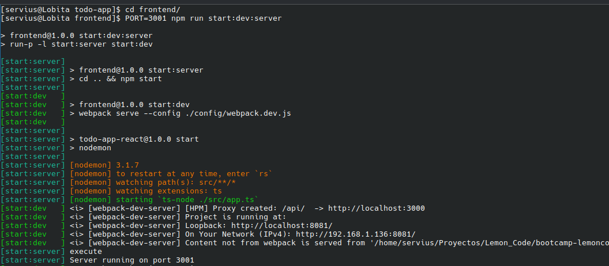

##### > aplicacion todo corriendo en el buscador

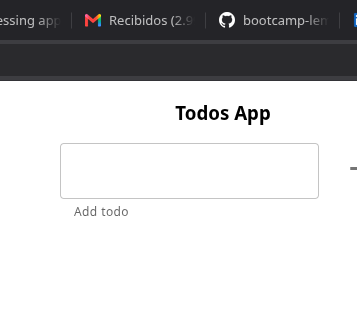


```bash
# Creando la imagen a partir del Dockerfile proporcionado
docker build -t sdesa/lc-todo-00monolith .

#he dejado el puerto tal como estaba, decidí usar production en la variable de entorno
docker run -d -p 3001:3001 \
> -e NODE_ENV=production \
> -e PORT=3001 \
> sdesa/lc-todo-00monolith
```

#### 1.1 Creando y lanzando la imagen
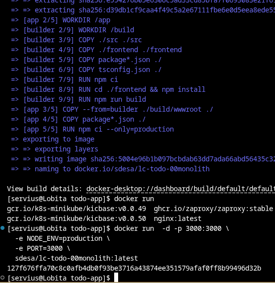

##### > La imagen funciona en browser
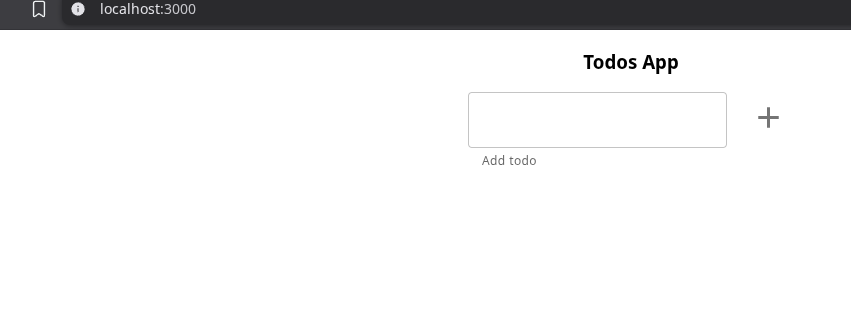


#### 1.1 Crendo el deployment
  ##### Archivo [deployment.yaml](/Bootcamp%20DevOps%20Continuo/02-orquestacion/00-monolith-in-mem/kubernetes/deployment.yaml)


> Nota: Intenté lanzar el deployment tal cual pero me tiró errimagepull, con un describe descubrí que está intentando pillar la imagen de un repositoiro no existem, y no localmente.

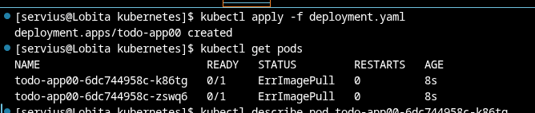
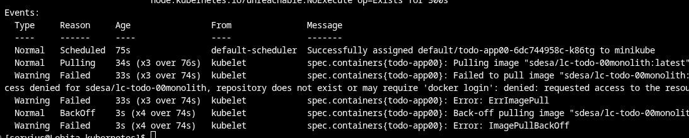


> Para que use la imagen sdesa/lc-todo-00monolith que tengo en local, necesito cargarla en minikube, además de añadir imagePullPolicy: Never en el deployment.yaml

```bash
minikube image load sdesa/lc-todo-00monolith 
```

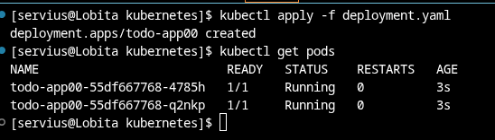


### Paso 2. Accedee a todo-app desde fuera del clúster

#### 2.1 Creamos el tunel en minikube para que mapee una ip al servicio que expondremos

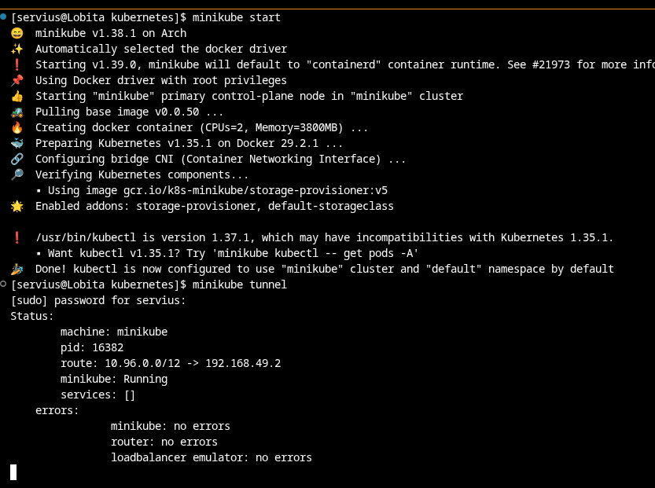

#### 2.2 Lanzamos de nuevo el deployment en otra terminal y lo exponemos

```bash
kubectl apply -f deployment.yaml
kubectl expose deployment todo-app00 --type=LoadBalancer --port=3000 --target-port=3000
```

> La parte de target port en principio no hacía falta, si no se pone --target-port usará el puerto en --port, lo dejo así por si quisiera usar un puerto distinto para el servicio expuesto y conservar la configuración del deployment.


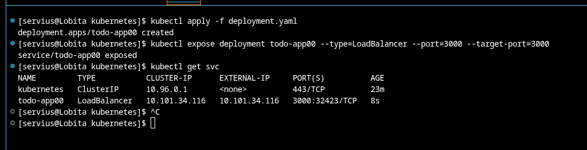
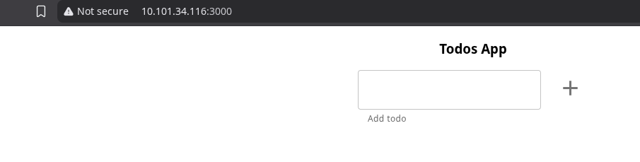

## Ejercicio 2. Monolito

### Paso 0. Probando la app con base de datos

```bash
# Creamos la base de datos para usarla localmente
docker run --rm -d -p 5432:5432 --name postgres postgres:16
```

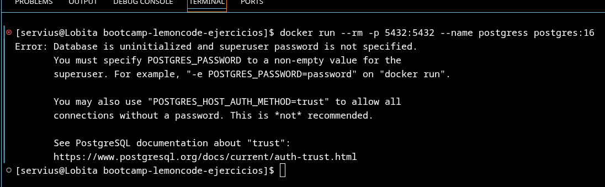
> Falla, si no tiene POSTGRES_PASSWORD en algun valor da fallo


```bash
docker run -d -e POSTGRES_PASSWORD="postgres" --rm  -p 5432:5432 --name postgres postgres:16
```

> Con el comando siguiente, le pegaríamos todo el código de la base de datos, pero este método no lo copia bien, por lo que decidía
```bash
docker exec -it postgres psql -U postgres
```
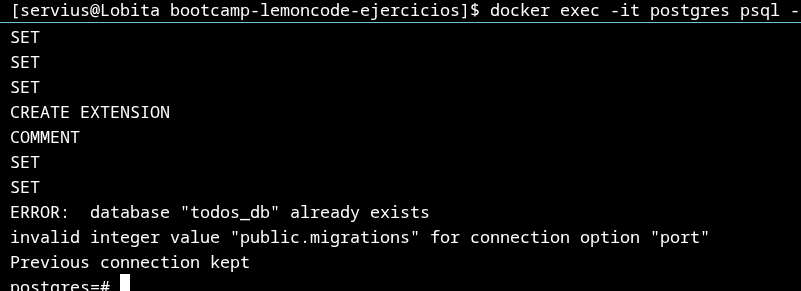

>Por ello decidí alimentar al comando el archivo directamente
```bash
docker exec -i postgres psql -U postgres < todo-app/todos_db.sql
```

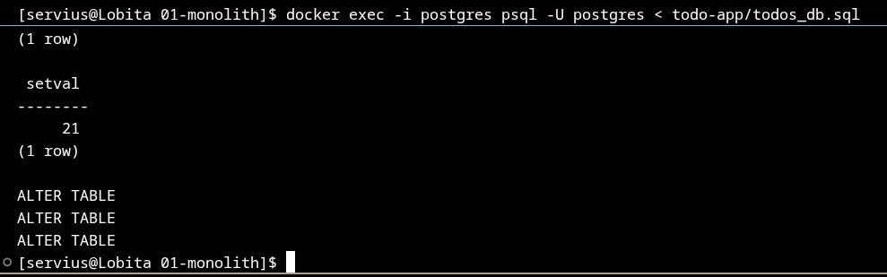


>Creamos el archivo de variables de entorno [.env](/Bootcamp%20DevOps%20Continuo/02-orquestacion/01-monolith/todo-app/.env)

Funciona

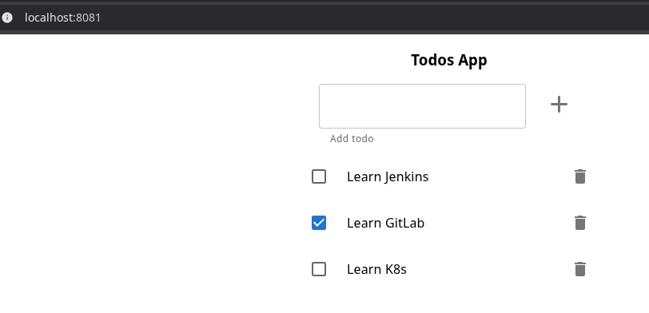

### Paso 1. Crear una capa de persistencia de datos

El ejercicio pide un StatefulSet para la BBDD, y para ello crear un ConfigMap, un StorageClass un PersistentVolume y un PersistentVolumeClaim que referencien al SC, un Cluster IP service para que los pods de la app puedan acceder al del StatefulSet

##### Nota: En el ejercicio me decía explicitamente que cree el PV directamente, a parte del PVC, no tenía claro si eso o si se esperaba que el PVC crease el PV dee manera dinámica, que me parecía una manera mejor, como no tenía claro si realmente debía hacer el PV manualmente, decidí hacerlo de las dos maneras 1° dejar que el PVC cree el PV, y 2°, crear el PV antes, dejé [aqui](/Bootcamp%20DevOps%20Continuo/02-orquestacion/01-monolith/kubernetes/db/PV_manual/pv.yaml) un yaml para un Volumen Persistente, se creará antes de empezar y que será reclamado por el PVC del ejercicio cuando este se cree

#### 1.0 Preparando la imagen que usaremos
> Antes de empezar, decidí seguir el consejo en el comentario al final del ejercicio y crear la imagen con la seed alimentada de otra forma, en lugar de usar una imagen "cocinada", optaré por montar la imagen en un volumen con un configMap, que me pareció lo más sencillo


Lanzamos el siguiente comando para que se genere el configMap en formato yaml.
##### Desde bootcamp-lemoncode-ejercicios/Bootcamp DevOps Continuo/02-orquestacion/01-monolith/kubernetes lanzo este comando:

```bash
kubectl create cm cm-db --from-file=todos_db.sql=../todo-app/todos_db.sql --dry-run=client -o yaml > db/cm-db.yaml
```

Me ha generado el [archivo configmap](/Bootcamp%20DevOps%20Continuo/02-orquestacion/01-monolith/kubernetes/db/cm-db.yaml) ya preparado


> Para probar que el config map funcionaría para pasar la seed de la BBDD, [creé un pods](/Bootcamp%20DevOps%20Continuo/02-orquestacion/01-monolith/kubernetes/tests/podtestdb.yaml) para alojar esta base de datos y, como es un testeo solo expondré este con un port-forward para ir rápido.

```bash
kubectl port-forward podtest 5432
```
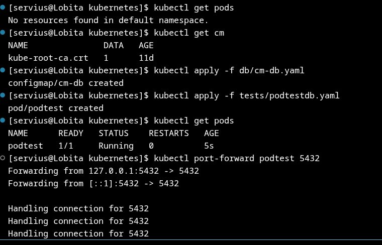
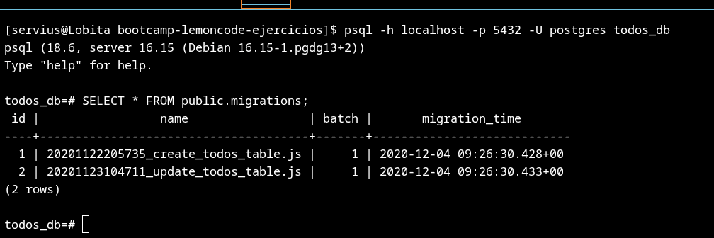

Se puede ver que el pod devuelve las tablas de la propia base de datos

#### 1.1 [ConfigMap](/Bootcamp%20DevOps%20Continuo/02-orquestacion/01-monolith/kubernetes/db/cm.yaml)

Se trata de un ConfigMap sencillo con solo la variable de entorno POSTGRES_USER, pues postgre solo necesitaría POSTGRES_USER y POSTGRES_PASSWORD (que iría en un secret más adelante)

#### 1.2 Secret

Los campos con información sensible, como la contraseña de la BBDD deben ir en un secret

##### El siguiente comando crearía añadiría el secret en el .yaml al etcd.
```bash
kubectl create secret generic pg-password --from-literal='POSTGRES_PASSWORD=<password>'
```
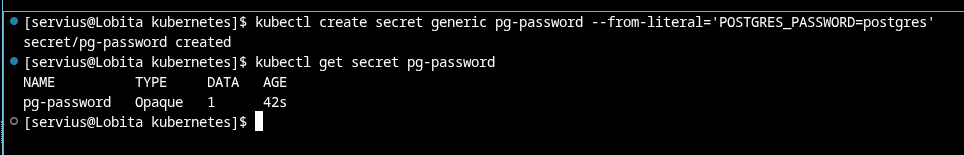


> Podría hacerse también con un archivo de configuracion secret.yaml que tuviese lo necesario, añadiendo este al .gitignore para que no aparezca en el repositorio y usándolo con kubectl apply, en tal caso tendríamos que copiar los valores a base64.


#### 1.3 [StorageClass](/Bootcamp%20DevOps%20Continuo/02-orquestacion/01-monolith/kubernetes/db/storageclass.yaml)


Me basé en la plantilla de esta página de [Kubernetes.io](https://kubernetes.io/docs/concepts/storage/storage-classes/#storageclass-objects) por que la extensión de kubernetes en VSCode no me daba ninguna plantilla.
Aquí tenían, entre otros ejemplos, la siguiente estructura básica

```yaml
apiVersion: storage.k8s.io/v1
kind: StorageClass
metadata:
  name: low-latency
  annotations:
    storageclass.kubernetes.io/is-default-class: "false"
provisioner: csi-driver.example-vendor.example
reclaimPolicy: Retain # default value is Delete
allowVolumeExpansion: true
mountOptions:
  - discard # this might enable UNMAP / TRIM at the block storage layer
volumeBindingMode: WaitForFirstConsumer
parameters:
  guaranteedReadWriteLatency: "true" # provider-specific
```

>Es una StorageClass sencilla, por lo tanto se han cambiado y quitado muchos de los campos que traía la plantilla, dejo una descripción de qué se cambió y que no y por qué:


* metadata.name: low-latency

Quería un nombre más descriptivo y lo cambié a "sclass-todos".

* annotations.storageclass.kubernetes.io/is-default-class: false

Si esta opción está en true en más de un StorageClass, un PVC creado sin especificar un SC usaría el más reciente, decidí dejarlo en false ya que no le sacaría ninguna ventaja en este entorno.

* provisioner: csi-driver.example-vendor.example

Para saber que proveedor necesitaría en local, usando minikube necesitaba saber cual usaba minikube por defecto, recurrí al siguiente comando: 
***kubectl get sc*** y ví que era k8s.io/minikube-hostpat y ese puse.

* reclaimPolicy: Retain

Con esta opción en "Retain", incluso si se borrase el PVC, el PV seguiría existiendo, para un caso como este no me sirve y tendría que borrar el PV manualmente después cuando el ejercicion termine y deje de usarlo, por lo que preferí cambiarlo a "Delete".

* allowVolumeExpansion: true

No necesitaré aumentar el tamaño de ningun volunmen por lo que la dejo en "False".

* mountOptions

No necesito ninguna opción de montaje especial así que borré este campo. 

* volumeBindingMode: WaitForFirstConsumer

La opción por defecto es "Immediate mode", mientras que "WaitForFirstConsumer" sería más útil hasta donde pude investigar, en un entorno más grande con varios nodos, decidí dejarlo en immediate.

* parameters:
  guaranteedReadWriteLatency: "true"

No necesitamos ningún parámetro en específico, la plantilla venía con guaranteedReadWriteLatency pero no haría falta para este ejercicio.


#### 1.4 [PersistentVolume](/Bootcamp%20DevOps%20Continuo/02-orquestacion/01-monolith/kubernetes/db/PV_manual/pv.yaml) que referencie al StorageClass anterior

No estaba claro si el PV se tendría que crear automáticamente con el PVC o no, lo que hay aquí es la version con el PV manual.
En la version con PV manual, preferí crearlo con almacenamiento local en lugar de el hostPath que el StorageClass y el PVC usarían en la versión dinámica.

Primero es necesario crear en minikube el path al directorio local que se montará en este PV:

```bash
minikube ssh
sudo mkdir -p /mnt/kubediscos/postgrepvmanual
```

Un PV con almacenamiento en "local" necesita registrar también el campo nodeAffinity, para el cual necesitamos conocer cuál es el hostname del nodo minikube

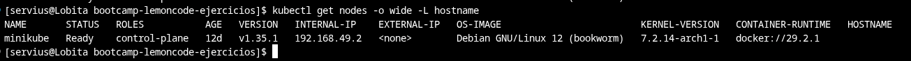

Con esto los campos local y nodeAffinity están cubiertos.

#### 1.5 [Persistent Volume Claim](/Bootcamp%20DevOps%20Continuo/02-orquestacion/01-monolith/kubernetes/db/pvc.yaml)

Con configurar el campo storageClassName al que usamos en este ejercicio "sclass-todos" es suficiente. Este PVC creará un Volumen si no existe, o suará el que se ha creado manualmente de ser necesario.

#### 1.6 [Cluster IP Service](/Bootcamp%20DevOps%20Continuo/02-orquestacion/01-monolith/kubernetes/db/service.yaml)

El ClusterIP permitirá que la app que despleguemos acceda a la base de datos sin exponerla fuera del cluster. El valor del campo spec.selector debe coincidir con el statefulset. Se puede crear con una ip por defecto pero es mejor dejar que kubernetes le asigne una automáticamente y acceder mediante el nombre del ClusterIP service.

#### 1.7 [StatefulSet](/Bootcamp%20DevOps%20Continuo/02-orquestacion/01-monolith/kubernetes/db/stateset.yaml)

El StatefulSet para la BBDD solo tendrá una réplica, se usará la versión 16 del contenedor de postgre

Usamos el volumen PVC, referenciandolo en el campo volumes.persistentVolumeClaim.claimName bajo un nombre que referencio también en VolumeMounts con el mountPath /var/lib/postgresql/data.
Para la seed de la base de datos, el configMap que hemos creado en el paso 0 como un volumen, referenciándolo en VolumeMounts con el mountPath /docker-entrypoint-initdb.d/, con el que postgre inicializa la base de datos si no existe una.

Al usar el PVC "todosdb-pv-claim", funcionará tanto si el PV se crea de manera manual o automática.


El PV se creó manualmente y está correctamente unido al PVC, mientras que la base de datos inicializada con la seed que nos proporciona el ejercicio es totalmente accesible desde dentro del cluster accedemos desde otro pod para comprobarlo.

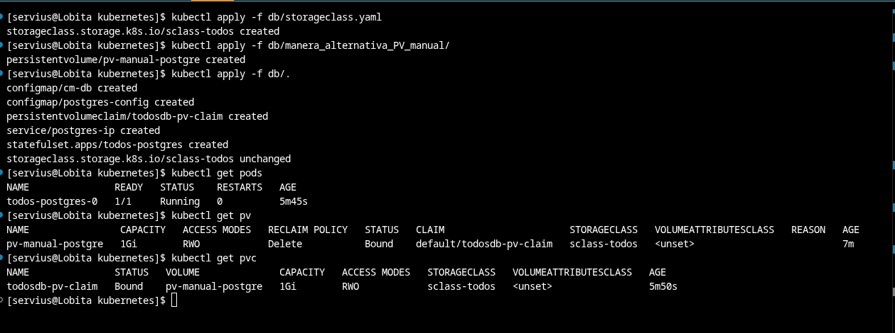

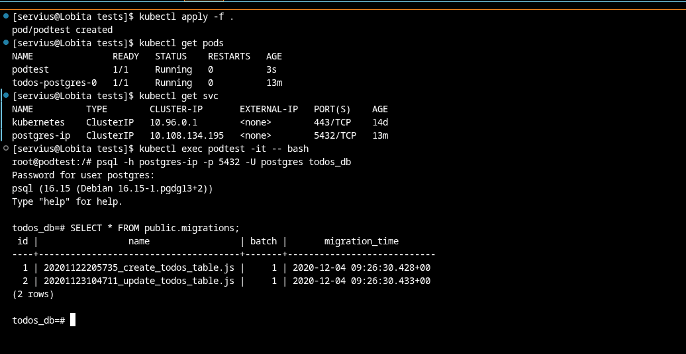


En el siguiente se puede vver que el PV cambió y ahora se usa uno generado dinámicamente


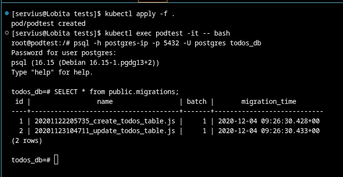

### Paso 2. Crear todo-app


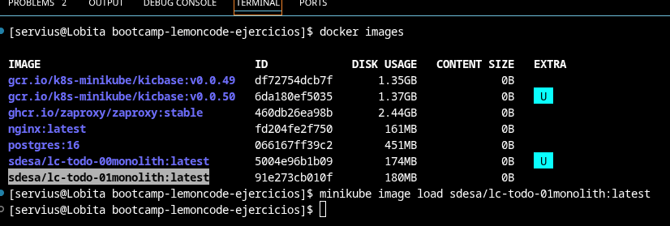

> Importamos la imagena  minikube como con la anterior

El deployment que se usará se puede comprobar [aquí](/Bootcamp%20DevOps%20Continuo/02-orquestacion/01-monolith/kubernetes/app/deployment.yaml)

Para mandarle las variables de entorno, las metemos con [este ConfigMap](/Bootcamp%20DevOps%20Continuo/02-orquestacion/01-monolith/kubernetes/app/cm.yaml)

### Paso 3. Crear un LoadBalancer Service


